# Building a Linux and a Windows test machine in VirtualBox

This guide builds two virtual machines (VMs) on one laptop, starting from nothing:

* `lab01-ubuntu` — Ubuntu Server 26.04.1 LTS (Linux)
* `lab02-windows` — Windows 11 Enterprise LTSC Evaluation

Both VMs can reach the internet and see each other, and each has a saved "clean" state you can return to in a few seconds if something breaks. You do not need any IT knowledge. Do the steps in order and do not skip the **Check** lines: they tell you whether to continue or stop.

The VirtualBox in the screenshots is in Russian. English names are given in brackets, e.g. **Создать** (New).

---

## 0. What you need

| Item | Requirement | Why |
|---|---|---|
| Laptop | Windows 10/11, **16 GB RAM**, **100 GB free disk**, 4+ CPU cores | The two VMs together take 6 GB RAM and up to 89 GB disk (25 + 64). The rest of the RAM is left for the laptop itself. |
| Virtualisation | Switched on in the BIOS (called Intel VT-x or AMD-V / SVM) | Without it VirtualBox cannot start 64-bit VMs. Most laptops have it on. If a VM refuses to start, see Troubleshooting, problem 1. |
| Internet | About 9 GB of downloads | VirtualBox (~100 MB) + Ubuntu ISO (~2 GB) + Windows ISO (~6 GB). |
| Time | About 2 hours, mostly waiting for installers | |

**Licences.** VirtualBox and Ubuntu are free. Windows is the Enterprise **Evaluation** version: free, no key, but valid for 90 days. After that it must be rebuilt or the company must buy a licence. For a short-lived test machine this is acceptable.

---

## 1. Download everything first

Put all downloads in the `Downloads` folder.

### Step 1. Download and install VirtualBox
1. Open `https://www.virtualbox.org/wiki/Downloads` in a browser.
2. Click **Windows hosts** and run the downloaded `.exe`.
3. Click **Next** on every screen and **Install** at the end. A warning that the network will be briefly disconnected is normal: click **Yes**.

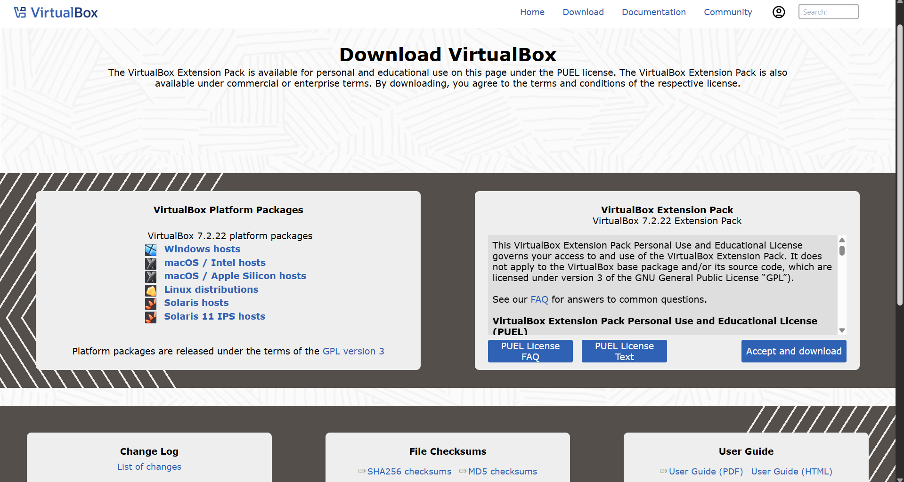

Why: VirtualBox is the free "hypervisor", the program that pretends to be a second computer inside your own.

> **Check:** VirtualBox opens and shows an empty list of machines on the left.

### Step 2. Download the Ubuntu Server ISO
1. Open `https://ubuntu.com/download/server`.
2. Download **Ubuntu Server 26.04.1 LTS** (file name `ubuntu-26.04.1-live-server-amd64.iso`, about 2 GB).

Why Server and not Desktop: Server has no graphical interface, so it needs far less memory and disk. A developer who needs a desktop can add one later.

> **Check:** the file is in `Downloads` and is about 2 GB.

### Step 3. Download the Windows 11 ISO
1. Open the Microsoft Evaluation Center (`https://www.microsoft.com/evalcenter`) and find **Windows 11 Enterprise**.
2. Choose the **ISO** download, language **English (United States)**, and download it (about 5–6 GB). The file name is `26100.1742.240906-0331.ge_release_svc_refresh_CLIENT_LTSC_EVAL_x64FRE_en-us.iso`.

Why this one: it is Microsoft's own free evaluation version, so it needs no product key. The limit is time: it works for 90 days, then it must be replaced or licensed.

> **Check:** the file is in `Downloads` and is about 5–6 GB.

---

## 2. Create a network the two VMs share

### Step 4. Create the NatNetwork
By default every VM gets its own private NAT, which gives it internet but hides it from other VMs. We need one shared network.

1. In VirtualBox click **Файл** (File) → **Инструменты** (Tools) → **Менеджер сети** (Network Manager).
2. Open the tab **Сети NAT** (NAT Networks) and click **Создать** (Create).
3. Name it `NatNetwork`. Leave the address range as it is (normally `10.0.2.0/24`) and make sure **DHCP** is switched on. Click **Применить** (Apply).

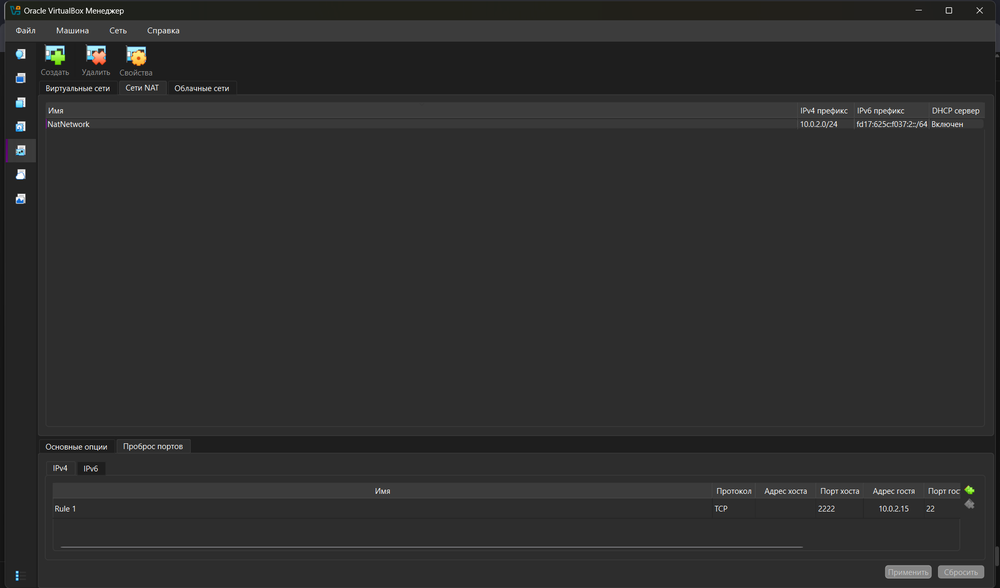

Why NAT Network and not Bridged: the Innotech teaching network filters by MAC address. A Bridged adapter gives the VM its own MAC, which the network rejects. Behind a NAT Network the VMs go out through the laptop's address, so there is nothing to reject, and they can still reach each other. If you build this at home and need to reach the VM from another computer, Bridged is the alternative, but then you must deal with filtering yourself.

> **Check:** `NatNetwork` appears in the list.

---

## Part A. The Ubuntu (Linux) VM

### Step 5. Open the New Machine wizard
1. Click **Создать** (New) in the toolbar.
2. **Имя ВМ** (Name): `lab01-ubuntu`.
3. **Образ ISO** (ISO Image): open the list, choose **Другой…** (Other…) and select the Ubuntu ISO.
4. Make sure **ОС** (Type) = `Linux`, **Дистрибутив ОС** (Subtype) = `Ubuntu`, **Версия ОС** (Version) = `Ubuntu (64-bit)`. VirtualBox fills these in itself.
5. Leave **Осуществить установку автоматически** (Proceed with Unattended Installation) **unticked**.

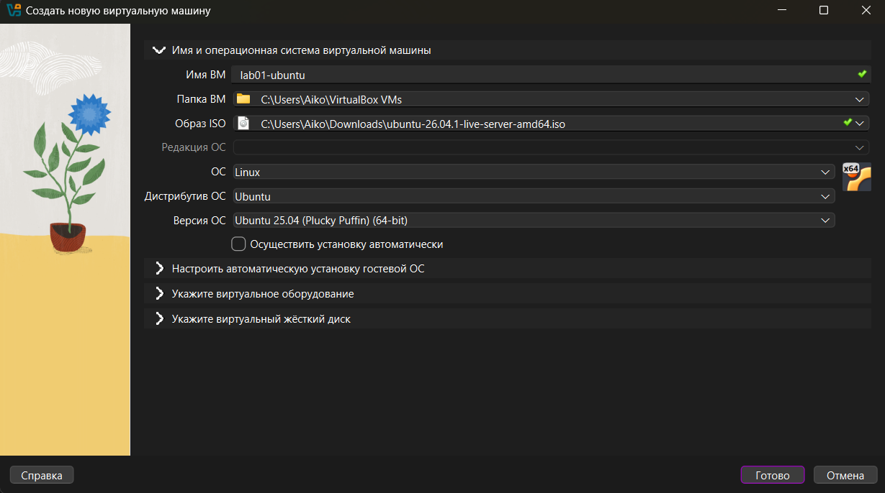

Why unticked: otherwise VirtualBox installs Ubuntu by itself with its own username and settings, and this guide would no longer match what you see.

> **Check:** the name is exactly `lab01-ubuntu`, the version says Ubuntu (64-bit) and the unattended box is empty. Do not click **Готово** (Finish) yet.

### Step 6. Memory and processors
Click **Укажите виртуальное оборудование** (Specify virtual hardware).
* **Основная память** (Base Memory): `2048 MB`.
* **Процессоры** (Processors): `2`.
* Leave **Включить EFI** (Enable EFI) **unticked** for Linux.

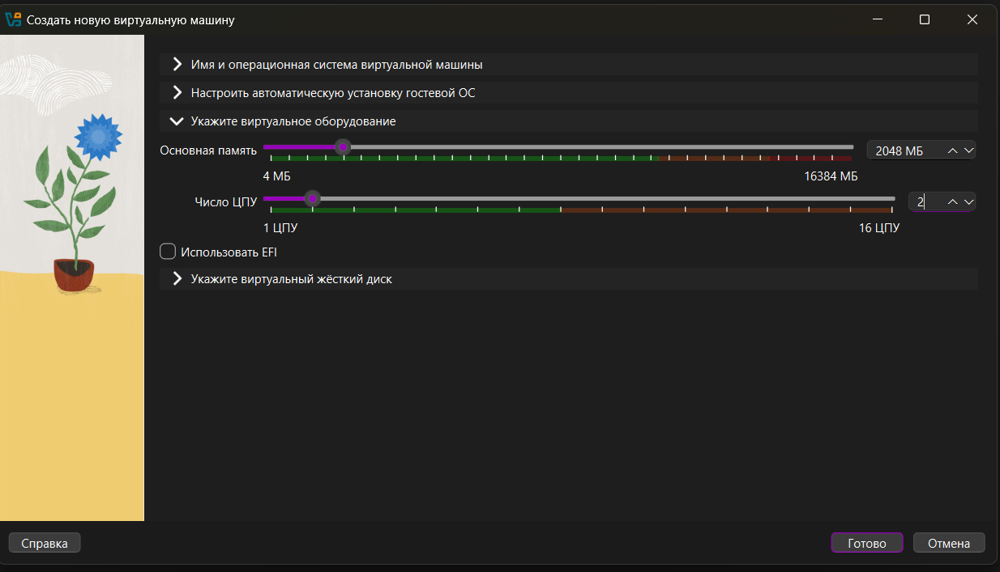

Why 2048 MB and 2 CPUs: the default (1024 MB, 1 CPU) is slow for a developer. Ubuntu Server runs comfortably on 2 GB. The laptop has 16 GB, so Ubuntu 2 GB + Windows 4 GB leaves 10 GB for the laptop itself. More than 2 GB for Linux would start squeezing the host when both VMs run.

> **Check:** Memory shows 2048 MB and Processors shows 2.

### Step 7. Virtual disk
Click **Укажите виртуальный жёсткий диск** (Specify virtual hard disk).
* Choose **Создать виртуальный жёсткий диск сейчас** (Create a Virtual Hard Disk Now) and set the size to `25 GB`.
* Leave **Выделить место в полном размере** (Pre-allocate Full Size) **unticked**.
* Click **Готово** (Finish).

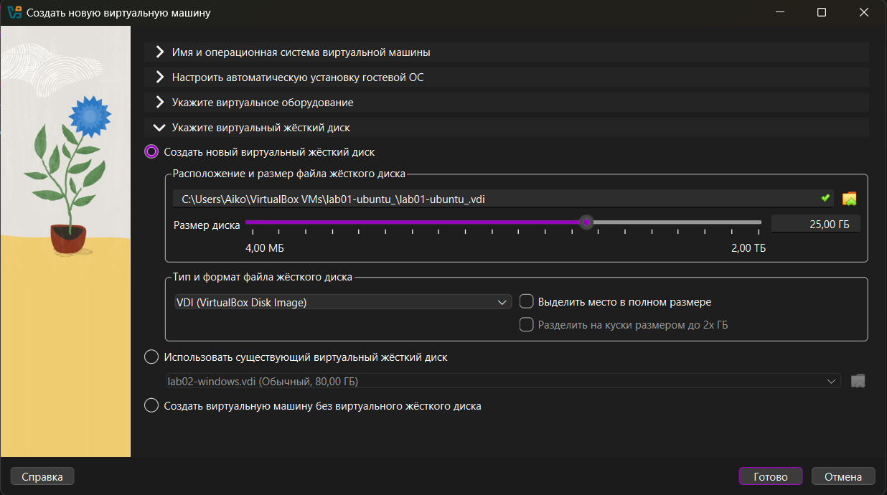

Why 25 GB, dynamic: a dynamic disk takes space on the laptop's SSD only as it fills. A fresh Ubuntu Server uses about 5 GB, so the 25 GB limit costs you 5 GB, not 25. Pre-allocation would take the full 25 GB at once and make the build slower for no benefit here.

To confirm: select the VM, **Настроить** (Settings) → **Носители** (Storage), click `lab01-ubuntu.vdi`.

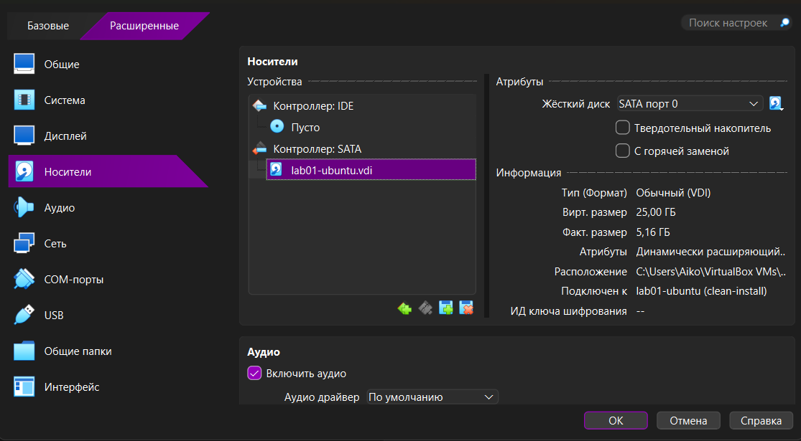

> **Check:** the panel on the right shows virtual size 25 GB and type "dynamically allocated".

### Step 8. Attach the VM to the NatNetwork
1. Select `lab01-ubuntu`, click **Настроить** (Settings) → **Сеть** (Network) → **Адаптер 1** (Adapter 1).
2. **Тип подключения** (Attached to): `Сеть NAT` (NAT Network).
3. **Имя** (Name): `NatNetwork`. Click **OK**.

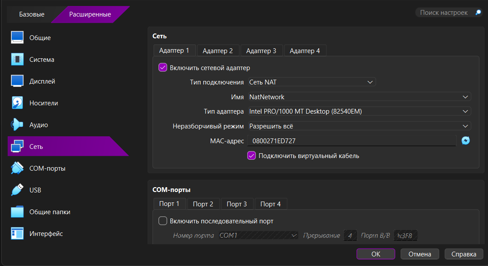

Why now: the Ubuntu installer asks for a network address at the start. If the adapter is already on NatNetwork, it gets one automatically.

> **Check:** the type says `Сеть NAT` (not just `NAT`) and the name says `NatNetwork`.

### Step 9. Install Ubuntu Server
Click **Запустить** (Start). A window opens. Click inside it, then use the keyboard (the mouse does not work in the installer). Press **Enter** to accept the highlighted choice, and use the arrow keys to move.

1. **GRUB menu:** press Enter on **Try or Install Ubuntu Server**.
2. **Language:** English.
3. **Keyboard:** English (US) → Done.
4. **Type of install:** *Ubuntu Server* (not "minimized").
5. **Network:** you should see an address like `10.0.2.x` → Done. If no address is shown, stop: see Troubleshooting, problem 3.
6. **Proxy:** leave empty → Done.
7. **Mirror:** leave the default → Done.
8. **Storage:** *Use an entire disk* → Done → Done → **Continue**. This formats only the virtual 25 GB disk. Your laptop's real disk is not touched.
9. **Profile:** your name; server name `lab01-ubuntu`; a username of your choice; a password you will remember.
10. **Ubuntu Pro:** *Skip*.
11. **SSH:** tick **Install OpenSSH server** (press Space) → Done. SSH lets you copy text out of the VM later.
12. **Featured snaps:** select nothing → Done.
13. Wait 5–10 minutes. When **Reboot Now** appears at the bottom, press Enter.
14. If the screen says "Please remove the installation medium, then press ENTER", press Enter. If the installer menu comes back instead, switch the VM off, open **Настроить** → **Носители** (Storage), remove the ISO from the optical drive and start again.

Why these answers: they are the installer's defaults except for the name, the SSH server and the disk choice. Defaults are used on purpose so the next person does not have to decide anything.

> **Check:** after the reboot you see `lab01-ubuntu login:`.

### Step 10. Check that Ubuntu works
Log in with your username and password (the password is invisible while you type, this is normal). Run:

```
uname -a
lsb_release -a
ip addr
```

* `uname -a` must start with `Linux lab01-ubuntu`.
* `lsb_release -a` must say `Ubuntu 26.04.1 LTS`.
* `ip addr`: under `enp0s3` find a line `inet 10.0.2.x/24`. **Write that number down**, you need it in Step 18.

> **Check:** all three commands print what is described above. The same output is saved in `evidence/04-guest-uname.txt`.

---

## Part B. The Windows 11 VM

### Step 11. Open the wizard for Windows
1. Click **Создать** (New).
2. **Имя ВМ**: `lab02-windows`.
3. **Образ ISO**: **Другой…** and select the Windows ISO.
4. The **Редакция ОС** (Edition) field is filled in by VirtualBox itself and is greyed out: `Windows 11 Enterprise LTSC Evaluation`. Do not change it.
5. Check that **ОС** = `Microsoft Windows`, **Версия ОС** = `Windows 11 (64-bit)`.
6. Leave **Осуществить установку автоматически** (Proceed with Unattended Installation) **unticked**.

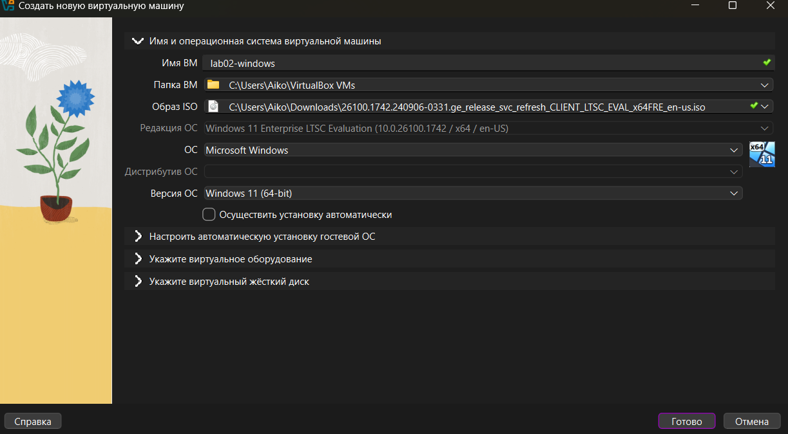

Why this edition: the Evaluation ISO contains only this one edition, so VirtualBox picks it itself and there is nothing to choose. It is free and needs no key, but works for 90 days.

> **Check:** name `lab02-windows`, version Windows 11 (64-bit), unattended box empty. Do not click Finish yet.

### Step 12. Memory, processors, disk
Click **Укажите виртуальное оборудование** (Specify virtual hardware) and set:
* **Основная память** (Base Memory): `4096 MB`.
* **Процессоры** (Processors): `2`.
* **Включить EFI** (Enable EFI): **ticked**.

Then click **Укажите виртуальный жёсткий диск** (Specify virtual hard disk):
* Size `64 GB`, **Выделить место в полном размере** (Pre-allocate Full Size) **unticked**.
* Click **Готово** (Finish).

Why: 4 GB RAM, 2 CPUs and 64 GB disk are Microsoft's official minimum for Windows 11; the installer refuses to continue below them. Dynamic allocation again means the laptop gives up only the space Windows actually uses (about 20–25 GB at first).

> **Check:** `lab02-windows` appears in the list on the left.

### Step 13. Turn on TPM and Secure Boot (critical)
Windows 11 refuses to install without a TPM 2.0 chip and UEFI. A VM has no real chip, so VirtualBox provides a virtual one. Do this **before** the first start.

1. Select `lab02-windows` → **Настроить** (Settings) → **Система** (System) → tab **Материнская плата** (Motherboard).
2. **Включить EFI** (Enable EFI): ticked.
3. **Включить безопасную загрузку** (Enable Secure Boot): ticked (this appears once EFI is on).
4. **Модуль TPM** (TPM): choose `v2.0`.

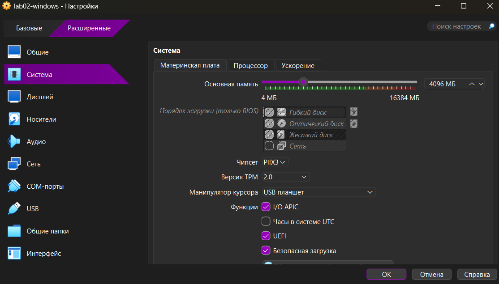

Why: skipping this is the most common reason the Windows installer stops with "This PC can't run Windows 11".

> **Check:** the settings above are visible exactly as in the screenshot. If the TPM list is missing, your VirtualBox is older than 7.0: update it (Step 1).

### Step 14. Attach Windows to the NatNetwork
**Настроить** → **Сеть** → **Адаптер 1**: **Тип подключения** = `Сеть NAT`, **Имя** = `NatNetwork`. Click **OK**.

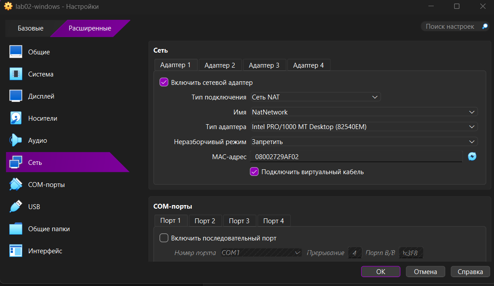

Why: the same network as Ubuntu is what lets the two machines talk. See Step 4.

> **Check:** same as in Step 8.

### Step 15. Install Windows
1. Click **Запустить** (Start). If you see **Press any key to boot from CD or DVD**, click inside the window and press any key **immediately** (the prompt disappears after a few seconds; if you miss it, use **Машина** → **Перезагрузить** and try again).
2. Language, time and keyboard: leave as is → **Next** → **Install now**.
3. If a **product key** screen appears, click **I don't have a product key**. The Evaluation version does not need one, and it may skip this screen.
4. If you are asked to choose an operating system, choose the only one offered (Windows 11 Enterprise Evaluation). Accept the licence → Next.
5. **Installation type:** **Custom: Install Windows only (advanced)**.
6. Select the single drive (Drive 0, 64 GB, unallocated) → Next. The VM restarts several times by itself; this takes 10–20 minutes. When "Press any key…" appears again, do **not** press anything, so that it boots from the new disk.
7. **First-run setup:** choose your region and keyboard; give the computer the name `lab02-windows` if asked.
8. **Sign-in:** if the installer insists on a Microsoft account, press **Shift+F10**, type `start ms-cxh:localonly` and press Enter, then enter a user name and password. (If that does not work, use the "Sign-in options" link or sign in with a Microsoft account.)
9. Answer the privacy questions with **Decline/No** and **Accept**.

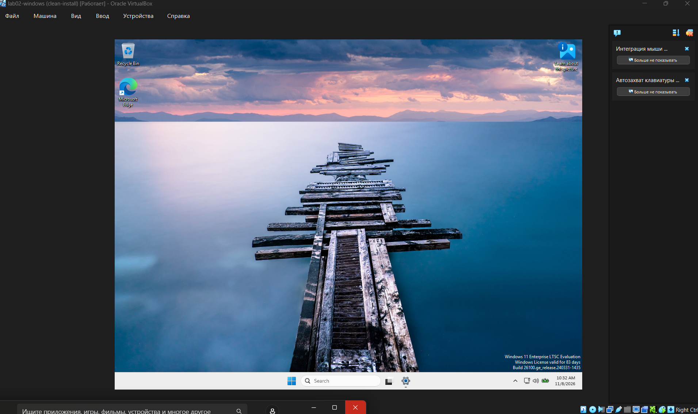

> **Check:** you see the Windows desktop and the Start button.

---

## Part C. Make the two machines reach each other and the internet

### Step 16. Check the internet from Windows
In Windows, click Start, type `PowerShell`, press Enter. Run:

```
ipconfig
ping 1.1.1.1
```

* `ipconfig`: **IPv4 Address** should be `10.0.2.x`. **Write it down.**
* `ping 1.1.1.1`: should say `Received = 4, Lost = 0 (0% loss)`.

Why `1.1.1.1` and not a website name: pinging an address tests the network only. A website name also needs the name service (DNS), so if it fails you would not know which of the two is broken.

> **Check:** 0% loss. If not, Troubleshooting, problem 3.

### Step 17. Allow ping into Windows
Windows blocks incoming ping by default, so Ubuntu would show 100% loss when it tries to reach Windows. In PowerShell, **run as administrator** (right-click PowerShell → *Run as administrator*) and paste:

```
New-NetFirewallRule -DisplayName "Allow Ping ICMPv4" -Protocol ICMPv4 -IcmpType 8 -Direction Inbound -Action Allow
```

Why this rule and not switching the firewall off: it opens only ping, and nothing else. Switching the firewall off removes all protection.

> **Check:** PowerShell prints a table of the new rule and no red text.

### Step 18. Ping in both directions
**On Ubuntu** (use the Windows address from Step 16):
```
ping -c 4 <Windows address>
ping -c 4 1.1.1.1
```
**On Windows** (use the Ubuntu address from Step 10):
```
ping <Ubuntu address>
```
Each one must end with `0% packet loss` (Ubuntu) or `0% loss` (Windows).

> **Check:** all three succeed. Example output is in `evidence/05-ping-between-guests.txt`. Use the file to see what "good" looks like, not as a substitute for doing the test.

---

## Part D. Save a clean state and go back to it

### Step 19. Take a snapshot of each VM
A snapshot freezes the machine exactly as it is now. The developer can break anything afterwards and return to this point.

1. Shut each VM down properly (Ubuntu: `sudo poweroff`; Windows: Start → Power → Shut down).
2. In VirtualBox select the VM, then click the **Снимки** (Snapshots) icon next to its name.
3. Click **Сделать** (Take).
4. Name it `clean-install` and click **OK**. Repeat for the other VM.

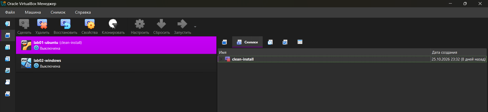
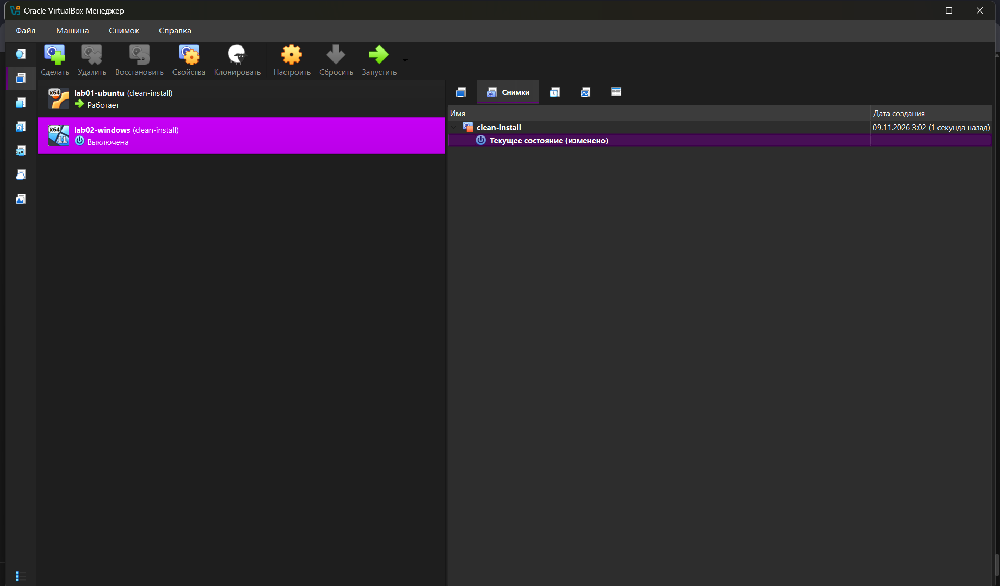

Why shut down first: a snapshot of a powered-off machine is smaller, quicker and cannot catch a half-written file.

> **Check:** each VM shows `clean-install` in its snapshot list.

---

## Rollback: how to undo the developer's damage

1. Shut the VM down (or **Машина** → **Закрыть** → **Выключить**).
2. Select the VM → **Снимки**.
3. Click `clean-install` → **Восстановить** (Restore).
4. When asked to save the current state, choose **No**/**Не сохранять** if you do not need it, and confirm.
5. Start the VM.

This normally takes a few seconds, not a rebuild. **Warning:** everything done since the snapshot is lost, including the developer's files. Tell them to keep anything important outside the VM.

> **Check:** the VM starts in the clean state, and files created after the snapshot are gone.

---

## Troubleshooting

| # | What you see | Likely cause | What to do |
|---|---|---|---|
| 1 | The VM does not start; message mentions `VT-x`, `AMD-V` or `VERR_VMX_NO_VMX` | Virtualisation is off in the BIOS (or Windows Hyper-V is using it) | Restart the laptop, open the BIOS (usually F2, F10 or Del at start), switch on *Intel Virtualization Technology* / *SVM Mode*, save. |
| 2 | Windows installer says "This PC can't run Windows 11" | TPM/EFI not enabled, or less than 4 GB RAM / 64 GB disk / 2 CPUs | Shut the VM down. Redo Step 13 and check Step 12. |
| 3 | Ubuntu or Windows has no internet; Ubuntu installer shows no IP address | Adapter not on NatNetwork, or NatNetwork has no DHCP | Check Step 8 / 14. In Network Manager, open `NatNetwork` and make sure **DHCP** is ticked. |
| 4 | Ubuntu can ping Windows with 100% loss | Windows firewall blocks ping | Repeat Step 17 as administrator. |
| 5 | Both VMs have `10.0.2.15` and cannot see each other | They are on plain `NAT`, not on `NAT Network` | Set the adapter type to `Сеть NAT` (Step 8 / 14). |
| 6 | The Ubuntu installer starts again after "Reboot now" | The ISO is still inserted | Step 9, last point. |
| 7 | Windows boots to a black screen with a "Press any key" line that disappears | The key press was missed | **Машина** → **Перезагрузить** and press a key in time (Step 15). |
| 8 | Ubuntu "No space left on device" | The 25 GB virtual disk is full, or the laptop's SSD is full | Check free space on the laptop first; free up space or ask for a larger virtual disk. |

---

## Summary of the settings this guide sets

Where VirtualBox already proposes the same value, it is still listed, so that the build is the same every time.

| Setting | Value in this guide | Why |
|---|---|---|
| Network (both VMs) | NAT Network `NatNetwork` instead of plain NAT | VMs must see each other; the campus network filters Bridged adapters (Step 4) |
| Unattended installation (both VMs) | Unticked | The guide matches what is on screen (Steps 5, 11) |
| Ubuntu memory | 2048 MB | Smooth for a developer; leaves 10 GB for the laptop (Step 6) |
| Ubuntu CPUs | 2 | Responsive package installs |
| Ubuntu disk | 25 GB, dynamic | Uses about 5 GB at first (Step 7) |
| Windows memory | 4096 MB | Windows 11 minimum (Step 12) |
| Windows CPUs | 2 | Windows 11 minimum |
| Windows disk | 64 GB, dynamic | Windows 11 minimum; no need for more on a test machine |
| Windows EFI, Secure Boot, TPM | On, v2.0 | Windows 11 will not install without them (Step 13) |
| Windows firewall | Ping allowed in | So Ubuntu can reach Windows (Step 17) |
