# Building a Linux and a Windows test machine in VirtualBox

This guide builds two virtual machines (VMs) on one laptop, starting from nothing:

* `lab01-ubuntu` — Ubuntu Server 26.04.1 LTS (Linux)
* `lab02-windows` — Windows 11 Enterprise LTSC Evaluation

A virtual machine is a simulated computer running inside your real laptop (the *host*). Both VMs can reach the internet and communicate with each other, and each has a saved "clean" snapshot you can restore in a few seconds if the developer breaks anything. You do not need any IT background. Follow the steps in order and verify every **Check** line before moving on.

The VirtualBox interface in the screenshots is in Russian. English button names are shown in brackets, e.g. **Создать** (New).

---

## 0. What you need

| Item | Requirement | Why |
|---|---|---|
| Laptop | Windows 10/11, **16 GB RAM**, **120+ GB free disk**, 4+ CPU cores | The two VMs use 6 GB RAM combined (2 GB + 4 GB) and up to 105 GB disk (25 + 80 GB), leaving 10 GB RAM for the laptop itself. |
| Virtualisation | Enabled in BIOS/UEFI (Intel VT-x or AMD-V / SVM) | Without hardware virtualisation, VirtualBox cannot run 64-bit VMs. Open *Task Manager → Performance → CPU* and confirm **Virtualization** says *Enabled*. |
| Internet | About 9 GB of downloads | VirtualBox (~100 MB) + Ubuntu ISO (~2 GB) + Windows ISO (~6 GB). |
| Time | About 1.5–2 hours (mostly installer progress bars) | |

**Licences:** VirtualBox and Ubuntu are completely free. Windows is the official **Enterprise Evaluation** edition: free and needs no product key, but expires after 90 days. After 90 days it must be rebuilt or licensed by the company.

---

## 1. Download everything first

Save all files into your `Downloads` folder.

### Step 1. Download and install VirtualBox
1. Open `https://www.virtualbox.org/wiki/Downloads` in a browser.
2. Under **VirtualBox Platform Packages**, click **Windows hosts** (this guide uses VirtualBox `7.2.22`) and run the downloaded `.exe` installer.
3. Click **Next** on every screen and **Install** at the end. A warning that your network connection will briefly reset is normal — click **Yes**.
4. Do **not** download the *Extension Pack* shown on the same page. This guide does not need it, and its licence allows only personal and educational use.

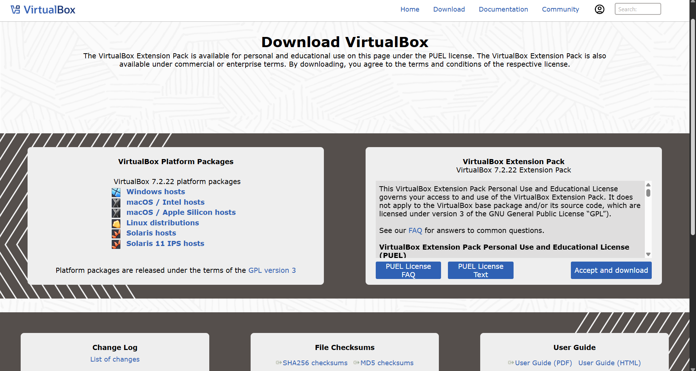

Why: VirtualBox is the free (GPLv3) hypervisor that runs the virtual computers inside Windows. Only the Extension Pack has a restricted licence, so skipping it keeps the office on the safe side.

> **Check:** VirtualBox opens and displays an empty machine list on the left.

### Step 2. Download the Ubuntu Server ISO
1. Open `https://ubuntu.com/download/server`.
2. Download **Ubuntu Server 26.04.1 LTS** (`ubuntu-26.04.1-live-server-amd64.iso`, ~2 GB).

Why Server and not Desktop: Server has no graphical desktop, so it needs far less RAM and disk space. A developer can install a GUI later if needed.

> **Check:** `ubuntu-26.04.1-live-server-amd64.iso` is in `Downloads` (~2 GB).

### Step 3. Download the Windows 11 Enterprise Evaluation ISO
1. Open `https://www.microsoft.com/en-us/evalcenter/evaluate-windows-11-enterprise`.
2. Click **Download the ISO** (Enterprise LTSC / Enterprise Evaluation), fill in the basic form if prompted, choose **64-bit** and language **English (United States)**, and download the `.iso` file (`26100.1742.240906-0331.ge_release_svc_refresh_CLIENT_LTSC_EVAL_x64FRE_en-us.iso`, ~5–6 GB).

Why this ISO: it is Microsoft's legal, free evaluation copy for testing and does not require a product key (unlike regular consumer Windows 11 ISOs).

> **Check:** the Windows `.iso` file is in `Downloads` (~5–6 GB).

---

## 2. Create a shared virtual network

### Step 4. Create `NatNetwork`
By default, VirtualBox puts each VM on an isolated NAT where it has internet access but cannot see other VMs. We need one shared network.

1. In VirtualBox, click **Файл** (File) → **Инструменты** (Tools) → **Менеджер сети** (Network Manager).
2. Open the **Сети NAT** (NAT Networks) tab and click **Создать** (Create).
3. Name it `NatNetwork`, keep the default IPv4 prefix (`10.0.2.0/24`), and ensure **DHCP сервер** (DHCP) is enabled.
4. *(Optional, recommended)* Under **Проброс портов** (Port Forwarding) → **IPv4**, add a TCP rule forwarding host port `2222` to guest `10.0.2.15` port `22`, then click **Применить** (Apply). Make sure the Ubuntu IP you get in Step 10 matches the guest IP in this rule. Once Ubuntu is installed, you can connect from Windows Terminal with:

```powershell
ssh -p 2222 <username>@127.0.0.1
```

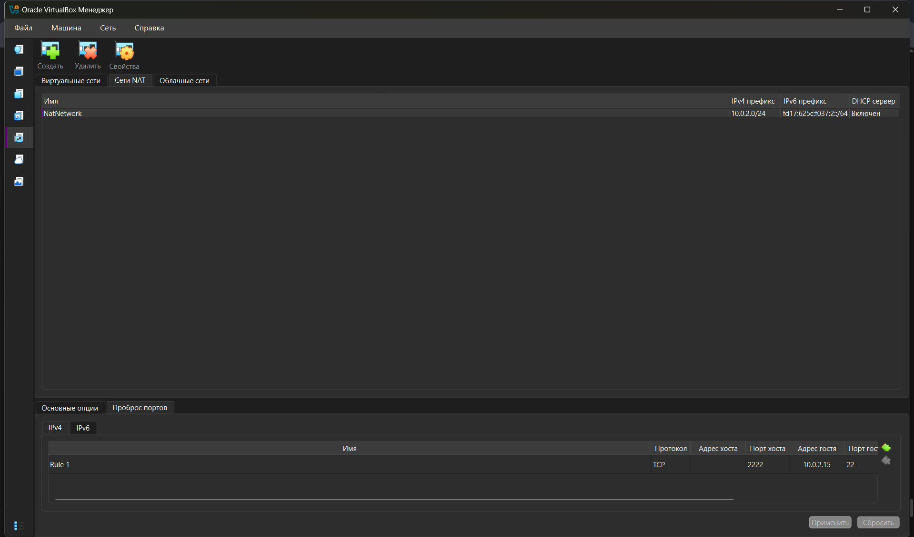

Why NAT Network instead of Bridged: the Innotech network filters unknown MAC addresses and blocks Bridged VMs. Behind a NAT Network, both VMs share the host's external address (so nothing is blocked) while remaining able to ping each other on `10.0.2.0/24`.

> **Check:** `NatNetwork` appears in the NAT Networks list with `10.0.2.0/24` and DHCP enabled.

---

## Part A. The Ubuntu (Linux) VM

### Step 5. Create the VM in the wizard
1. Click **Создать** (New) in the main toolbar.
2. **Имя ВМ** (Name): `lab01-ubuntu`.
3. **Образ ISO** (ISO Image): select **Другой…** (Other…) and pick `ubuntu-26.04.1-live-server-amd64.iso`.
4. Confirm **ОС** (Type) = `Linux` and **Дистрибутив ОС** (Subtype) = `Ubuntu`. VirtualBox will auto-select the closest 64-bit Ubuntu version (e.g. `Ubuntu 25.04 (Plucky Puffin) (64-bit)` or `Ubuntu (64-bit)`) — leave that as is.
5. Leave **Осуществить установку автоматически** (Proceed with Unattended Installation) **unticked**.

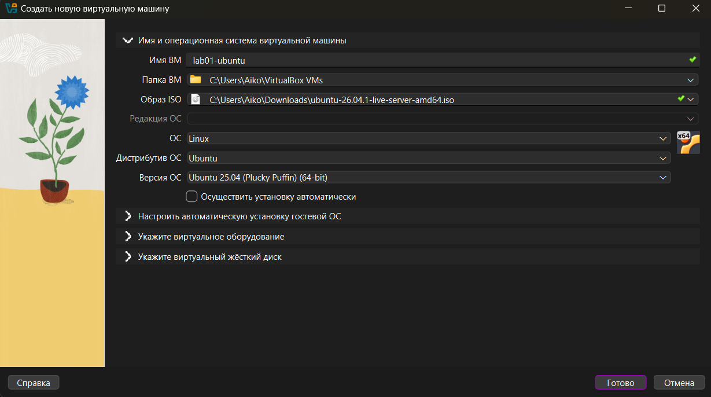

Why unticked: unattended installation auto-fills hidden usernames and passwords and skips the installer screens shown in this guide.

> **Check:** Name is `lab01-ubuntu`, OS is Linux / Ubuntu (64-bit), and unattended installation is unticked. Do not click **Готово** (Finish) yet.

### Step 6. Configure memory and processors
Expand **Укажите виртуальное оборудование** (Specify virtual hardware):
* **Основная память** (Base Memory): `2048 MB`.
* **Число ЦПУ** (Processors): `2`.
* Leave **Использовать EFI** (Enable EFI) **unticked** (Ubuntu Server boots with standard BIOS here).

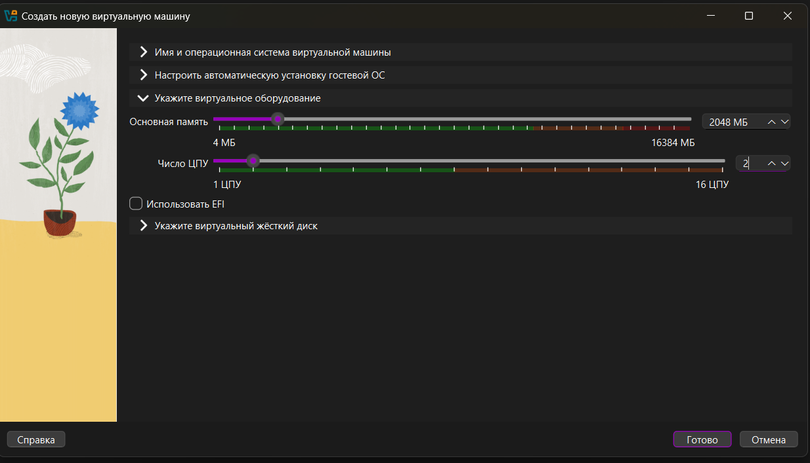

Why 2048 MB and 2 CPUs: VirtualBox defaults to 1024 MB and 1 CPU, which is slow for package installs. 2 GB runs Ubuntu Server smoothly while leaving 10 GB RAM free for the host when Windows (4 GB) is also running.

> **Check:** Memory shows `2048 МБ` and Processors shows `2`.

### Step 7. Configure the virtual disk
Expand **Укажите виртуальный жёсткий диск** (Specify virtual hard disk):
* Select **Создать новый виртуальный жёсткий диск** (Create a Virtual Hard Disk Now) and set **Размер диска** (Size) to `25,00 ГБ` (25 GB).
* Leave **Выделить место в полном размере** (Pre-allocate Full Size) **unticked**.
* Click **Готово** (Finish).

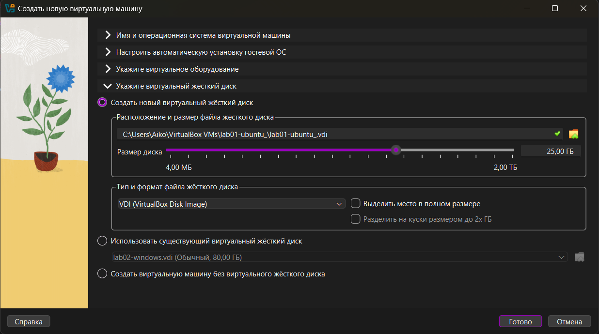

Why 25 GB dynamic: a dynamically allocated disk only uses space on your laptop's SSD as files are written inside the VM (`5,16 ГБ` initially instead of locking all 25 GB immediately).

To verify: select `lab01-ubuntu` → **Настроить** (Settings) → **Носители** (Storage) → click `lab01-ubuntu.vdi`.

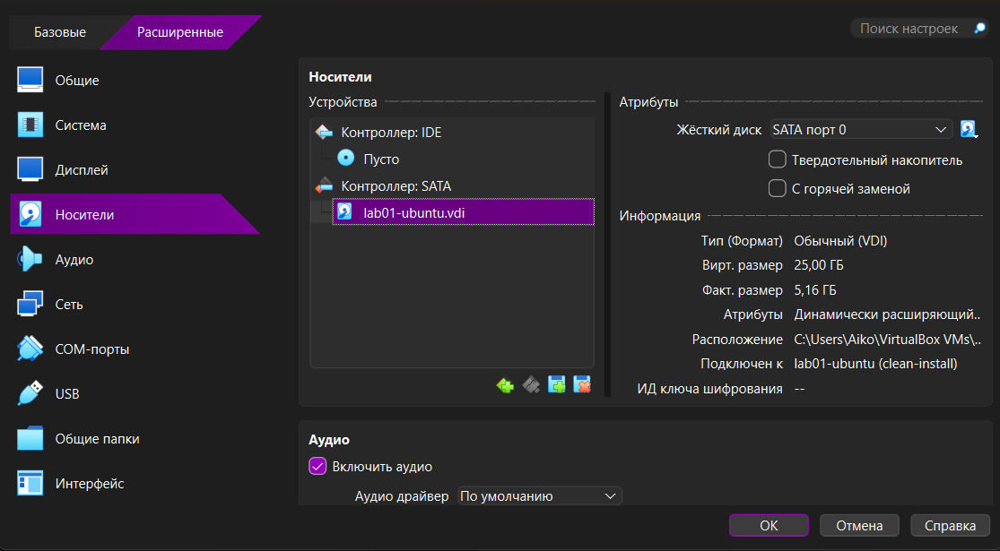

> **Check:** the right-hand panel shows **Вирт. размер** `25,00 ГБ` and **Атрибуты** `Динамически расширяющийся` (Dynamically allocated).

### Step 8. Attach Ubuntu to `NatNetwork`
1. Select `lab01-ubuntu` → **Настроить** (Settings) → **Сеть** (Network) → **Адаптер 1** (Adapter 1).
2. **Тип подключения** (Attached to): `Сеть NAT` (NAT Network).
3. **Имя** (Name): `NatNetwork`. Click **OK**.

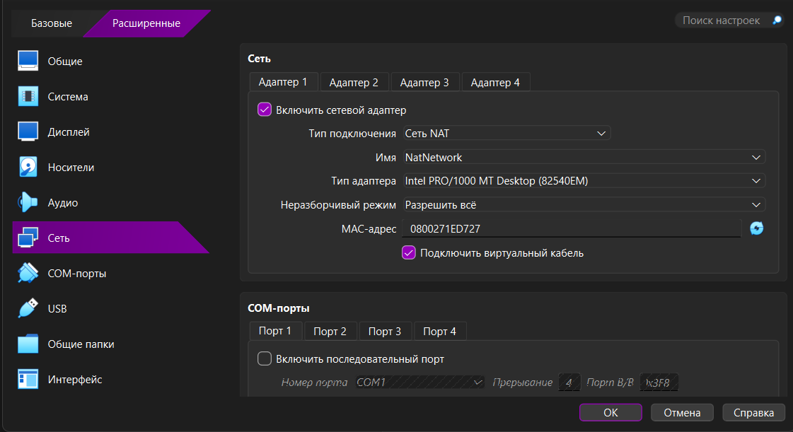

Why before installation: the Ubuntu installer automatically fetches an IP address (`10.0.2.x`) from `NatNetwork` during setup.

> **Check:** Attached to says `Сеть NAT` (not plain `NAT`) and Name says `NatNetwork`.

### Step 9. Install Ubuntu Server
Click **Запустить** (Start). Click inside the black VM window and navigate with the keyboard (**Arrow keys**, **Space** to toggle checkboxes, **Enter** to confirm).

1. **GRUB menu:** press **Enter** on *Try or Install Ubuntu Server*.
2. **Language:** `English`.
3. **Keyboard:** `English (US)` → **Done**.
4. **Type of install:** `Ubuntu Server` (leave minimized unticked) → **Done**.
5. **Network connections:** wait until `enp0s3` shows an IPv4 address like `10.0.2.x/24` → **Done**.
6. **Proxy address:** leave blank → **Done**.
7. **Mirror address:** keep default → **Done**.
8. **Guided storage configuration:** select **Use an entire disk** → **Done** → **Done** → **Continue**. (This only formats the virtual 25 GB file, never your real laptop drive.)
9. **Profile setup:** enter your name, server name `lab01-ubuntu`, a username, and a password you will remember → **Done**.
10. **Ubuntu Pro:** select *Skip for now* → **Continue**.
11. **SSH Setup:** press **Space** to tick **Install OpenSSH server** → **Done**.
12. **Featured Server Snaps:** select nothing → **Done**.
13. Wait 5–10 minutes until **Reboot Now** appears at the bottom, then press **Enter**.
14. If prompted *"Please remove the installation medium, then press ENTER"*, press **Enter**.

Why these choices: OpenSSH allows remote terminal connections and clean text copying later, while skipping snaps keeps installation fast.

> **Check:** after reboot, the console displays `lab01-ubuntu login:`.

### Step 10. Verify Ubuntu and check disk allocation
Log in with your username and password (characters are hidden while typing), or connect via SSH from Step 4. Run:

```bash
uname -a
lsb_release -a
hostname
df -h /
ip addr
```

* `uname -a` starts with `Linux lab01-ubuntu`.
* `lsb_release -a` shows `Ubuntu 26.04.1 LTS`.
* `ip addr` shows `inet 10.0.2.x/24` under `enp0s3` (in this build: `10.0.2.15`, recorded in `evidence/05-ping-between-guests.txt`). **Write this IP down** for Step 18.
* Note on `df -h /`: Ubuntu's default LVM layout allocates `12G` of the 25 GB disk initially (`5.6G` used). If the developer ever needs the full 25 GB, run the command below (keep the space between `+100%FREE` and `/dev/...`):

```bash
sudo lvextend -r -l +100%FREE /dev/ubuntu-vg/ubuntu-lv
```

> **Check:** all commands succeed without errors; the exact unedited output is saved in `evidence/04-guest-uname.txt`.

---

## Part B. The Windows 11 VM

### Step 11. Create the Windows VM in the wizard
1. Click **Создать** (New).
2. **Имя ВМ** (Name): `lab02-windows`.
3. **Образ ISO** (ISO Image): **Другой…** (Other…) and select the Windows 11 Evaluation ISO.
4. **Редакция ОС** (Edition) auto-fills as `Windows 11 Enterprise LTSC Evaluation`.
5. Confirm **ОС** = `Microsoft Windows`, **Версия ОС** = `Windows 11 (64-bit)`.
6. Leave **Осуществить установку автоматически** (Proceed with Unattended Installation) **unticked**.

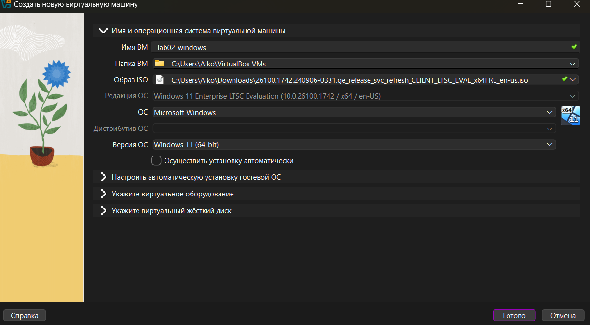

Why unticked: avoids auto-creating hidden accounts and ensures you can configure a local user cleanly.

> **Check:** Name is `lab02-windows`, Version is `Windows 11 (64-bit)`, unattended box is unticked. Do not click Finish yet.

### Step 12. Configure memory, processors, and disk
1. Expand **Укажите виртуальное оборудование** (Specify virtual hardware):
   * **Основная память** (Base Memory): `4096 MB`.
   * **Число ЦПУ** (Processors): `2`.
   * **Использовать EFI** (Enable EFI): **ticked**.
2. Expand **Укажите виртуальный жёсткий диск** (Specify virtual hard disk):
   * Leave the size at the default `80 GB` and leave **Выделить место в полном размере** (Pre-allocate Full Size) **unticked**.
3. Click **Готово** (Finish).

To verify: select `lab02-windows` → **Настроить** (Settings) → **Носители** (Storage) → click `lab02-windows.vdi`.

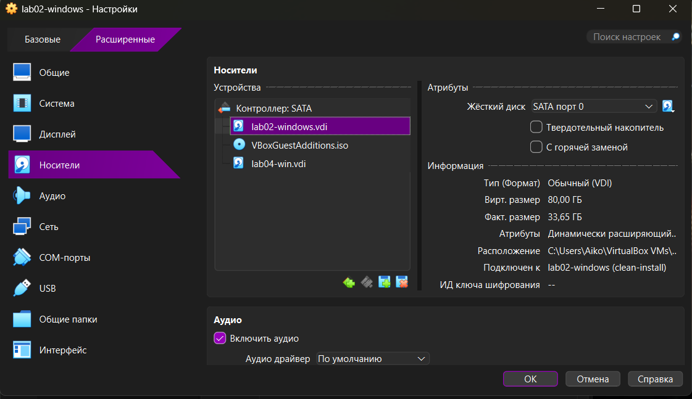

Why: Windows 11 needs at least 4 GB RAM, 2 CPUs and 64 GB of disk. The 80 GB default leaves room for updates, and a dynamic disk only takes the space that is actually written (about 34 GB after installation and updates).

> **Check:** the panel shows **Вирт. размер** `80,00 ГБ` and **Атрибуты** `Динамически расширяющийся`. Other entries in the list on that screenshot (`lab04-win.vdi`, `VBoxGuestAdditions.iso`) belong to later work and are not part of this guide.

### Step 13. Enable EFI, Secure Boot, and TPM 2.0 (critical)
Windows 11 refuses to install without UEFI, Secure Boot, and a TPM 2.0 chip. Configure this **before** starting the VM:

1. Select `lab02-windows` → **Настроить** (Settings) → **Система** (System) → **Материнская плата** (Motherboard).
2. **UEFI** (Enable EFI): **ticked**.
3. **Безопасная загрузка** (Enable Secure Boot): **ticked**.
4. **Версия TPM** (TPM): select `2.0`. Click **OK**.

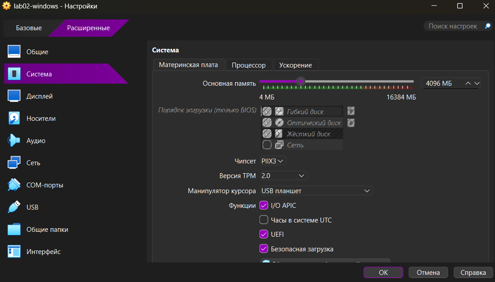

Why: omitting any of these three causes Windows Setup to abort with *"This PC can't run Windows 11"*.

> **Check:** `4096 МБ` RAM, UEFI, Безопасная загрузка, and Версия TPM `2.0` match the screenshot above.

### Step 14. Attach Windows to `NatNetwork`
Select `lab02-windows` → **Настроить** (Settings) → **Сеть** (Network) → **Адаптер 1** (Adapter 1): set **Тип подключения** (Attached to) = `Сеть NAT` (NAT Network) and **Имя** (Name) = `NatNetwork`. Click **OK**.

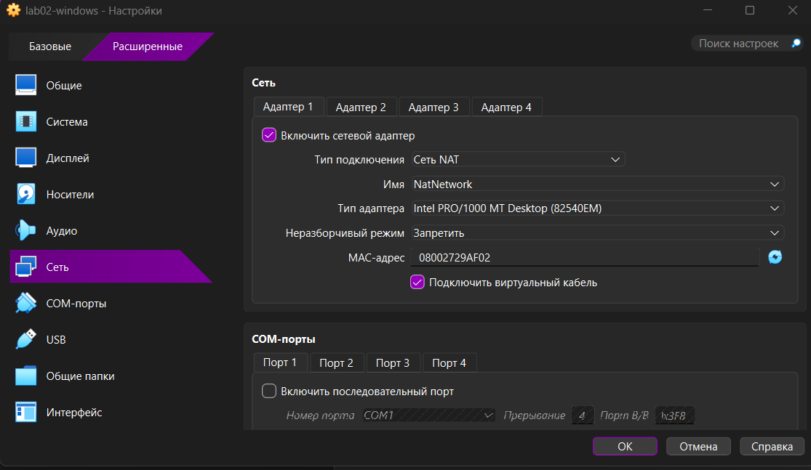

Why: places Windows on the exact same virtual subnet (`10.0.2.0/24`) as `lab01-ubuntu`.

> **Check:** Adapter 1 shows `Сеть NAT` and `NatNetwork`.

### Step 15. Install Windows 11
1. Click **Запустить** (Start). As soon as **Press any key to boot from CD or DVD** appears, click inside the VM window and press **Enter** or **Space** immediately.
2. Confirm Language/Keyboard → **Next** → **Install now**.
3. If prompted for a product key, click **I don't have a product key** (or select **Windows 11 Enterprise Evaluation** if asked for an edition). Accept the licence terms → **Next**.
4. Choose **Custom: Install Windows only (advanced)**.
5. Select **Drive 0 Unallocated Space** (80 GB) → **Next**. Windows will copy files and reboot several times (10–20 minutes). Do **not** press a key at *"Press any key…"* on subsequent reboots.
6. Complete the out-of-box setup (region, keyboard, device name `lab02-windows`).
7. If you are asked to sign in with a Microsoft account, press **Shift + F10**, type `start ms-cxh:localonly`, and create a local username and password. Decline optional telemetry/privacy toggles.

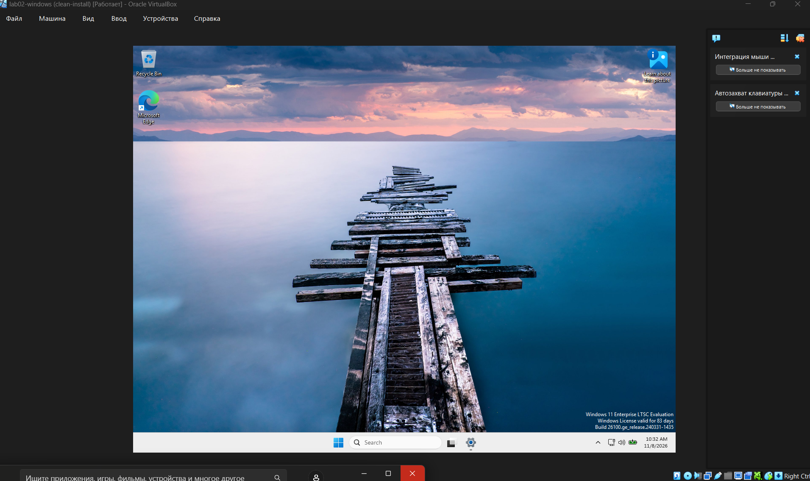

Why a local account: the machine is a test box, and a Microsoft account would tie it to a personal login.

> **Check:** you reach the Windows 11 desktop with the Start menu visible and the *Windows 11 Enterprise LTSC Evaluation* label in the bottom-right corner.

---

## Part C. Connect both guests and verify networking

### Step 16. Check IP address and internet on Windows
Open **Start**, type `PowerShell`, and press **Enter**. Run:

```powershell
ipconfig
ping 1.1.1.1
```

* Under Ethernet adapter, note the **IPv4 Address** (`10.0.2.x`; in this build: `10.0.2.3`, recorded in `evidence/05-ping-between-guests.txt`). **Write it down.**
* The ping must show `Lost = 0 (0% loss)`.

Why this ping: `1.1.1.1` is an internet address given as numbers, so a reply proves that traffic leaves the virtual network and reaches the internet.

> **Check:** `0% loss`.

### Step 17. Allow incoming ping on Windows Firewall
Windows blocks incoming ping (ICMPv4) by default, which causes Linux-to-Windows pings to time out. Open **PowerShell as Administrator** (right-click Start → *Terminal (Admin)* or search PowerShell → *Run as administrator*) and run:

```powershell
New-NetFirewallRule -DisplayName "Allow Ping ICMPv4" -Protocol ICMPv4 -IcmpType 8 -Direction Inbound -Action Allow
```

Why this rule instead of turning off the firewall: it opens only ICMP ping requests while keeping all other firewall protections active.

> **Check:** PowerShell outputs the new rule details with no red error text.

### Step 18. Verify bidirectional ping and internet from both guests
1. **On Ubuntu** (replace `<Windows-IP>` with `10.0.2.3` or your Windows IP from Step 16):

```bash
ping -c 4 <Windows-IP>
ping -c 4 1.1.1.1
```

2. **On Windows** (replace `<Ubuntu-IP>` with `10.0.2.15` or your Ubuntu IP from Step 10):

```powershell
ping <Ubuntu-IP>
```

Why both directions: a one-way ping can succeed while the other direction is blocked by a firewall (this is exactly what Step 17 fixes).

> **Check:** every ping returns replies with `0% packet loss`; the unedited logs from both machines are saved in `evidence/05-ping-between-guests.txt`.

---

## Part D. Save a clean snapshot and test rollback

### Step 19. Take the `clean-install` snapshot on both VMs
1. Shut down both VMs cleanly:
   * Ubuntu: run `sudo poweroff`
   * Windows: **Start → Power → Shut down**
2. In VirtualBox, select `lab01-ubuntu`, click the menu icon next to its name → **Снимки** (Snapshots).
3. Click **Сделать** (Take), name it `clean-install`, and click **OK**.
4. Repeat items 2–3 of this step for `lab02-windows`.

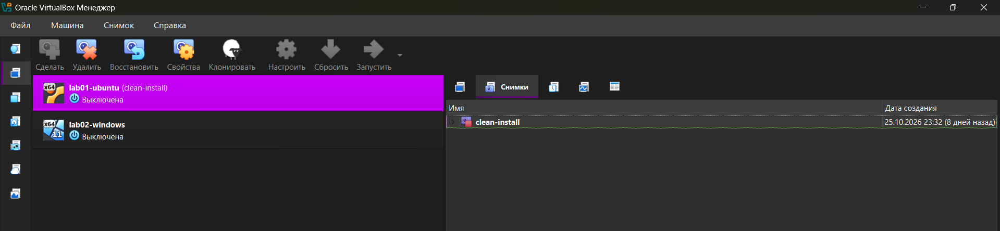

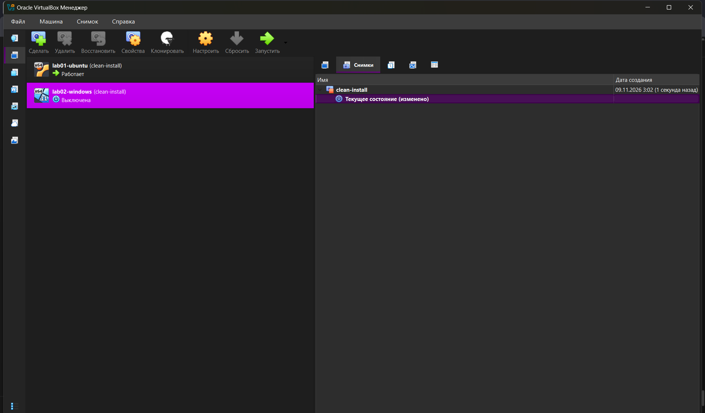

Why shut down first: snapshots taken while powered off are smaller, faster, and avoid capturing half-written disk buffers.

> **Check:** both VMs list `clean-install` under Snapshots.

### Step 20. Test and use Rollback (how to undo damage)
Whenever the developer breaks a VM or wants a fresh start, restore the snapshot:

1. To test rollback safely, boot `lab01-ubuntu`, create a dummy test file (`touch ~/broken-test.txt`), and shut the VM down (`sudo poweroff`).
2. In VirtualBox, select the VM → **Снимки** (Snapshots).
3. Select `clean-install` and click **Восстановить** (Restore).
4. Untick *"Создать снимок текущего состояния машины"* (Create a snapshot of the current machine state) so you do not save the broken state, then click **Восстановить** (Restore).
5. Start the VM.

Why untick: otherwise VirtualBox saves the broken state as a new snapshot and clutters the list.

> **Check:** the VM boots back into its clean state in seconds, and `~/broken-test.txt` (or any damage made after the snapshot) is completely gone. **Note:** remind the developer to store any work they want to keep outside the VM before rolling back.

---

## Troubleshooting

| # | Symptom | Cause | Fix |
|---|---|---|---|
| 1 | VM fails to start with `VERR_VMX_NO_VMX` or `VT-x / AMD-V` error | Hardware virtualisation is disabled in BIOS/UEFI | Reboot the laptop, open BIOS (F2/F10/Del), enable *Intel VT-x* or *AMD SVM Mode*, save and exit. |
| 2 | Windows Setup says *"This PC can't run Windows 11"* | EFI, Secure Boot, TPM 2.0, 4 GB RAM, or a disk of at least 64 GB is missing | Power off the VM and repeat Steps 12 and 13. |
| 3 | Windows boots to a small black 640×480 screen and freezes | Virtual graphics controller mismatch | Power off the VM → **Настроить** (Settings) → **Дисплей** (Display) → set **Графический контроллер** (Graphics Controller) to `VMSVGA` → start again. |
| 4 | VM shows *Aborted* or disk shows *Inaccessible* (`VERR_FILE_NOT_FOUND`) | The VM or its files were removed while the VM was still running | Always power off a VM before removing it. Right-click the broken entry → **Удалить** (Remove) and recreate it from Step 5 or Step 11. |
| 5 | Both VMs get the exact same IP (`10.0.2.15`) and cannot ping each other | Adapters are set to plain `NAT` instead of `Сеть NAT` (NAT Network) | Change Adapter 1 on both VMs to `Сеть NAT` → `NatNetwork` (Steps 8 and 14) and reboot both guests. |
| 6 | Ubuntu pings Windows with 100% packet loss, even on `NatNetwork` | Windows Firewall is blocking incoming ICMPv4 Echo | Run the `New-NetFirewallRule` command in PowerShell as Administrator (Step 17). |
| 7 | Ubuntu installer restarts from the beginning after *Reboot Now* | Virtual ISO image is still mounted in the optical drive | Power off the VM → **Настроить** (Settings) → **Носители** (Storage) → remove the `.iso` from the optical drive → start again. |
| 8 | Windows Setup skips *"Press any key to boot from CD or DVD"* | Key was not pressed within the 3-second prompt | Click **Машина** (Machine) → **Перезагрузить** (Reset), immediately click inside the window, and press **Space**. |
